# Zeus mode: play experience review for ages 11–14

Reviewed and improved locally on 14 October 2026. This is an adult review through
a young player's perspective, informed by the parent's report of an actual group
play session. No children participated in this review.

The main frustration was a repeated interruption: a full chant, a long freeze,
then a mistake that erased a level and half the movement energy. The large,
red-eyed floating face made the same interruption visually prominent. The course,
avatar customization, clear destination, and answer-to-refuel loop were worth
keeping.

## Flow and findings

All screenshots below were captured and inspected in the in-app browser during
this review. Earlier project audits and screenshots were not used as evidence.

| Step | Experience | Before | After |
| --- | --- | --- | --- |
| 1 | Join and customize | Healthy: no student account needed; choosing an avatar gives a sense of ownership. | Preserved. |
| 2 | Start and climb | Mixed: the route is clear, but the huge head dominates the sky and the message ties movement to constant chanting. | Improved: small smiling referee; simple “Your turn to climb”; long quiet movement windows. |
| 3 | Anticipate and freeze | Frustrating: short climbing intervals, long STOP windows, glowing red eyes, no advance visual warning. | Improved: amber countdown before STOP; brief freezes; one second to react; eyes stay their normal color. |
| 4 | Make a mistake and retry | Frustrating: live movement during STOP halved energy; the rules also removed an earned level. | Improved: retry the current level, preserve every checkpoint, keep 90% energy, and use a calm retry card and chime. |
| 5 | Answer and refuel | Healthy visual structure: readable questions, four large answer targets, and a separate signal above the question. Constant narration competes with reading. | Improved: local narration pauses while questions are open; answering still refuels and stays safe during STOP. |
| 6 | Choose sound settings | Limited control: the main sound setting affects all sounds; narration bypassed the SFX slider. | Improved: a saved voice switch, quieter voice gain, and narration routed through SFX volume and master mute. |
| 7 | Play in portrait or landscape | Existing answer layouts fit, but the large face distracts and the HUD blur covers part of the route. | Improved: smaller portrait referee and solid HUD; warning text stays visible in landscape. |

### 1. Join and customize

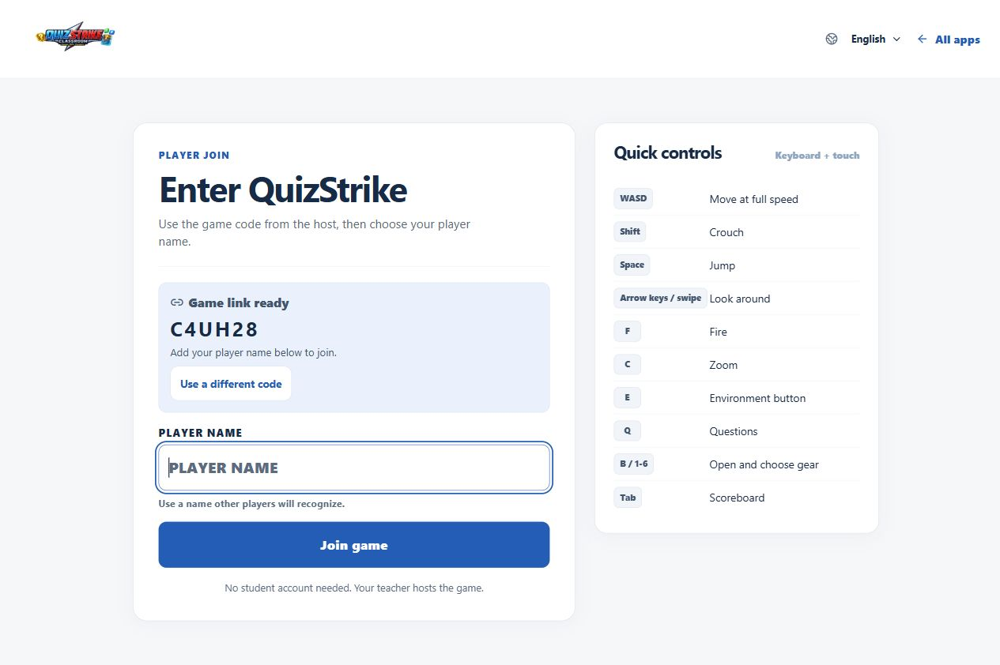
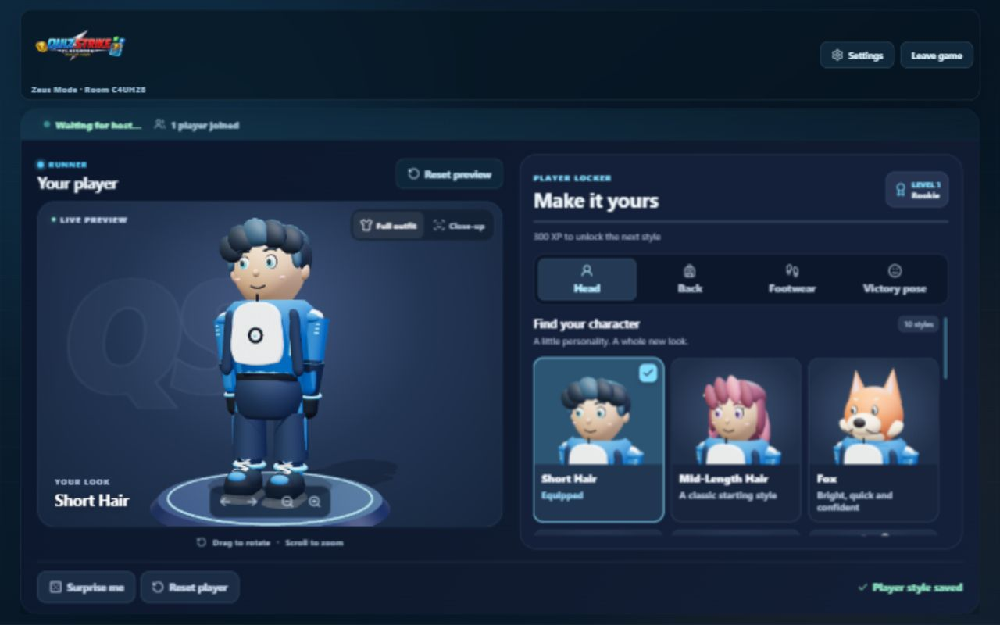

The entry and waiting room support independent participation. This review's
implementation stays focused on Zeus gameplay.

### 2. Start and climb

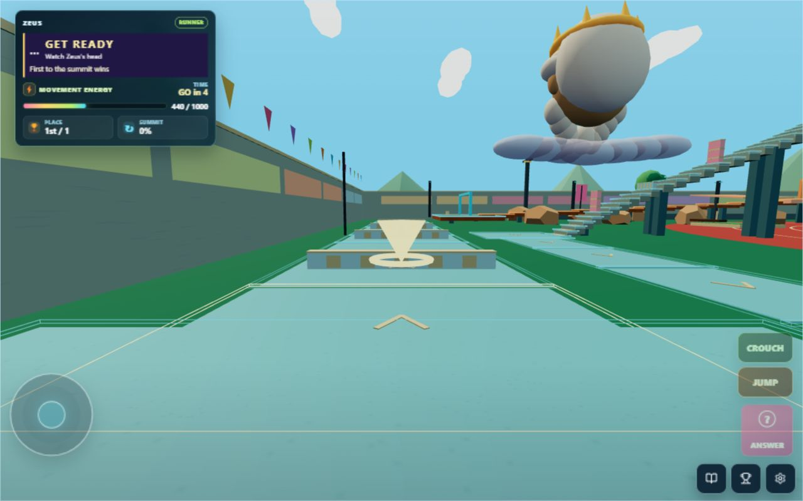
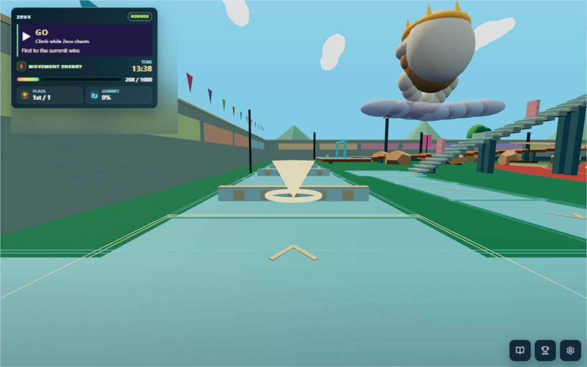
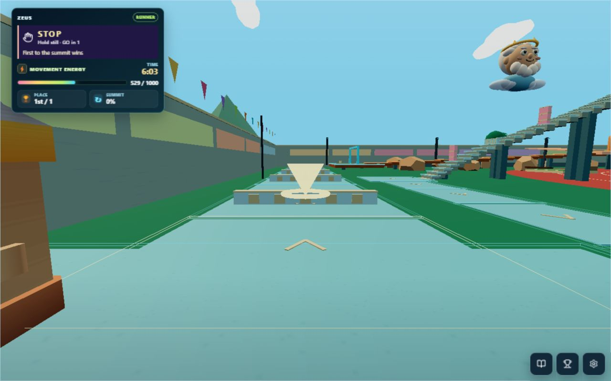

Young-player lens: “Let me get into a rhythm and see where I'm jumping.” Zeus
remains recognizable with his crown, white hair, beard, and cloud, but his smaller
blue-robed silhouette leaves the parkour route visible. The mouth stays in a
quiet smile rather than continually opening and closing.

### 3. Anticipate and freeze

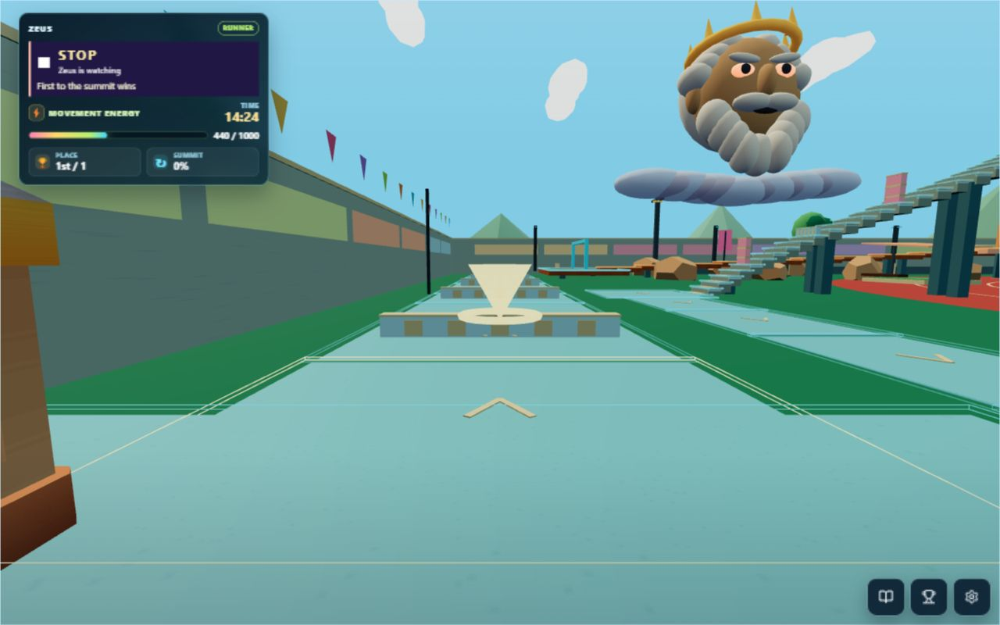
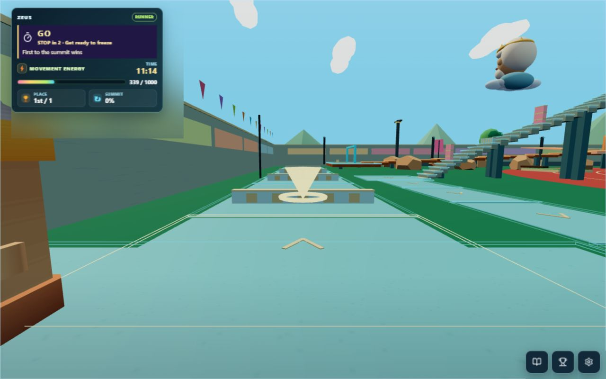

Young-player lens: “Give me a fair chance to stop.” The countdown appears during
the last 2.5 seconds of GO. GO remains the movement authority until STOP, and the
same warning appears during silent cycles and over an open question. Words and
different icons supplement the colors. There is no flashing warning.

### 4. Make a mistake and retry

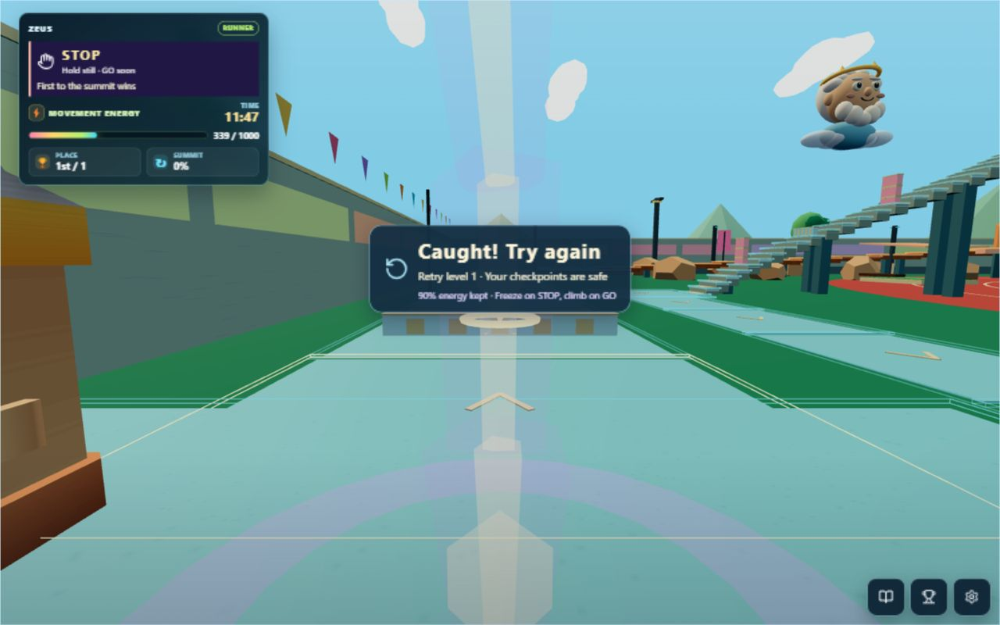

Young-player lens: “I made one mistake; I still want my progress to count.” The
server retains completed checkpoints and learning credit. The runner returns to
the safe start of their current level, with a 10% energy cost. Repeated packets
cannot trigger another penalty before the next GO. The message explains the next
action without shouting. Full-screen lightning and the electrical crack/thunder
combination were removed; the brief world impact remains.

The original penalty was observed in the live DOM and energy meter (440 became
220 after an initial STOP mistake). Its transient overlay could not be captured
in a matching before screenshot because browser captures trailed the live DOM;
that unsuccessful capture was not accepted as penalty evidence. The revised
retry image above was captured successfully and inspected.

### 5. Answer and refuel

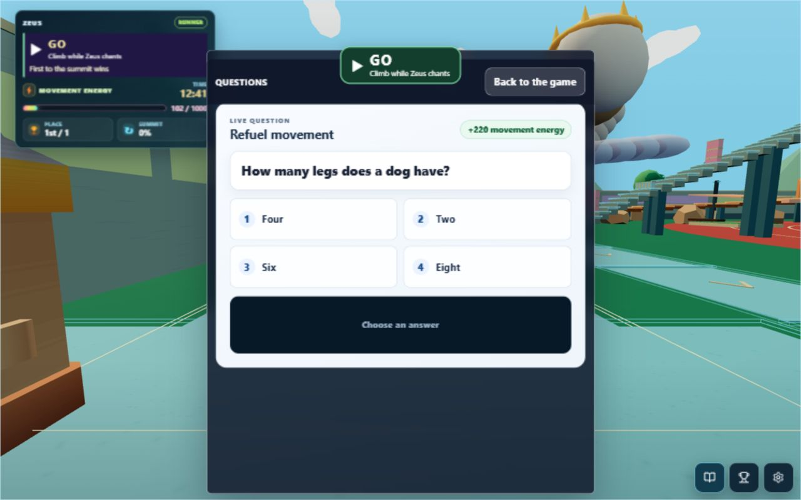
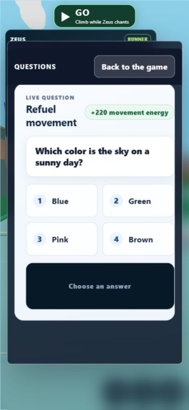
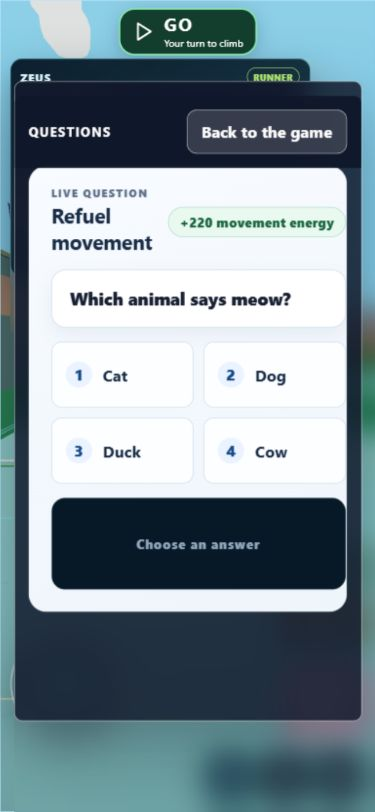
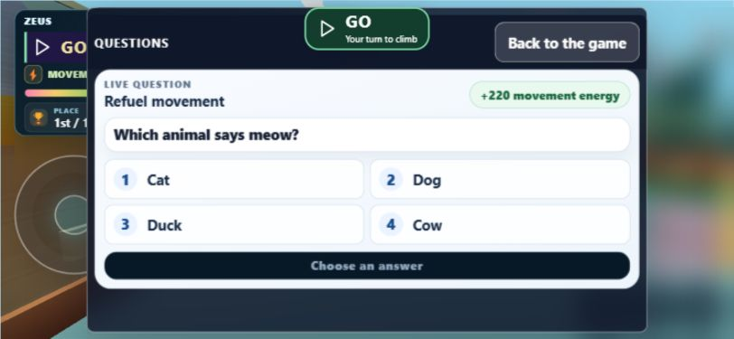

Young-player lens: “Let me read without the same voice talking over me.” On student
devices, the chant stops while a question or settings panel is open. Closing the
panel can resume only the remaining live portion of an eligible chant. Teacher
speaker narration remains shared across the room. Correct answers still award
220 movement energy; live verification observed 339 becoming 559. GO/STOP remains
visible independently of sound.

### 6. Choose sound settings

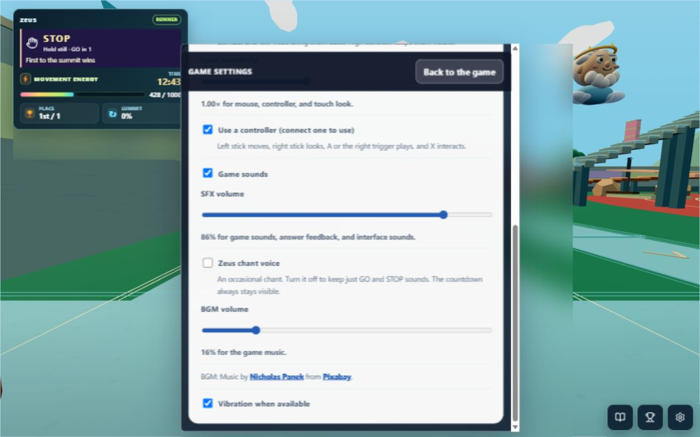

Young-player lens: “Let me turn off the annoying part and keep the useful cues.”
The independent voice switch persists after reloading and reconnecting. GO and
STOP cues continue. The voice gain is 0.4, then passes through the existing SFX
slider and master mute. Temporary playtest preferences were restored afterward.

### 7. Play in portrait or landscape

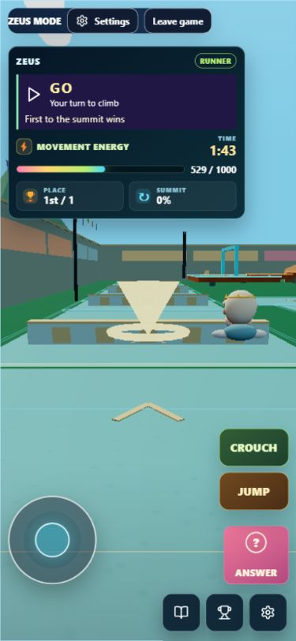
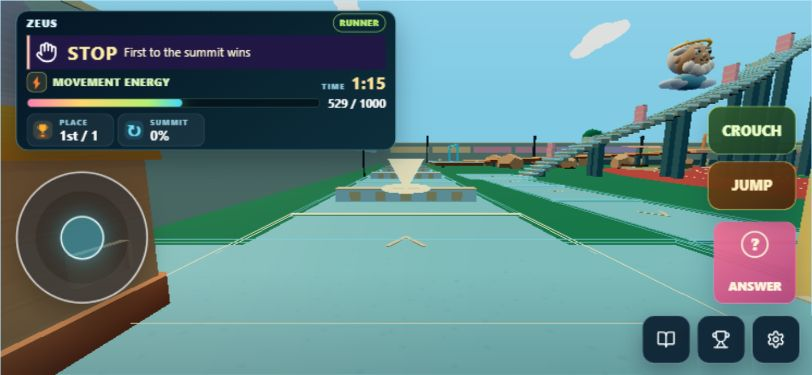

Portrait was checked at 375 × 812 and landscape at 812 × 375, with touch controls
explicitly enabled for the test. Phone answer targets measured 66 pixels high;
landscape targets measured 44 pixels and ended below the 375-pixel viewport edge.
The landscape HUD and joystick were separated by about 21 pixels outside the
warning. The final HUD removes backdrop blur to keep scenery around it clear.
The browser viewport and input preference were restored after testing.

## Timing changes

These are modeled timing budgets from the authored rules, not engagement
measurements from children. A 60-cycle sample with room seed 123 gives 86.9% GO
time and 1.09 voiced chants per minute after the changes.

| Rule | Before | After |
| --- | --- | --- |
| Climbing interval | 4.0–6.3 seconds | 18 seconds for the first two cycles; then 14–17.6 seconds |
| STOP interval | 3.6–4.8 seconds | 2.2–2.6 seconds |
| Advance visual warning | None | 2.5 seconds |
| Reaction allowance | 650 milliseconds | 1,000 milliseconds |
| Full chant | Every cycle, roughly six per minute | Every third cycle, roughly one per minute |
| Retry progress | Lose a completed level | Keep all completed checkpoints |
| Retry energy | Keep half | Keep 90% |

## Verification and limits

- 35 focused tests passed for timing, warning boundaries, chant synchronization,
  quiet audio routing, preference migration, recovery geometry, material state,
  lightning expiry, and teacher pause/resume.
- Both Zeus server integration tests passed: looking/answering during STOP,
  energy retention, learning credit, stale input rejection, recovery guards,
  and the first finisher winning at the summit.
- Web and server type checks passed; shared and web production builds passed.
- ESLint passed for changed TypeScript files and `git diff --check` passed.
- Live browser checks covered start, climbing, STOP, retry, answering, voice
  settings, persistence after reload, and desktop/portrait/landscape layouts.
- The pause screen was also checked, using teacher pause in a temporary local
  room; the paused screenshot is saved as `09-after-pause.jpg` and is not used as
  evidence of the unobscured character appearance.
- Existing Playwright expectations were updated for the new timing and feedback.
  The full Playwright browser suite was not run; interactive checks used the
  in-app browser.

The full six-district course was not manually completed in the browser. Summit
completion was verified by the server integration test. The existing parkour
geometry and ordinary fall recovery challenge remain part of the game. Screenshots
and DOM inspection do not establish complete accessibility compliance; screen
reader use, real phone performance, a multi-device classroom, and children's
enjoyment still need direct playtesting. Browser screenshots can trail live DOM
state, so captions describe the accepted image, rather than a later DOM snapshot.

The next useful check is a short session with the same ages 11–14 group: watch
whether they keep climbing after a mistake and whether anyone chooses to switch
off the occasional voice.
